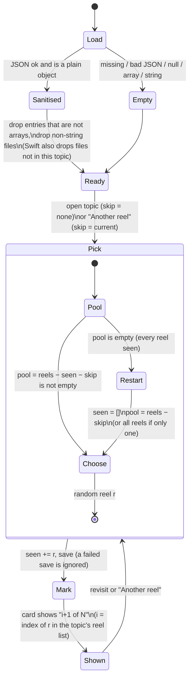

# Statecharts: reel rotation and lesson progress

These are the two pieces of state that live on the learner's device. Each runs in two places: the website (`learn/learn_panel.js`, `learn/learn_core.js`) and the SwiftUI app (`WhyNextCore` `ReelRotation`, `WhyNext/Views/ReelCard.swift`, plus the bundled web lesson inside `LessonWebView`). The TLA+ model in [`verify/`](../verify/) checks the invariants listed under each chart. Run it with `verify/run.sh`.

## 1. Reel picker and unseen-reel memory

Storage: `localStorage['wn_reels_seen']` on the web, and `@AppStorage("wn_reels_seen")` in the app. Both hold `{topicId: [file, ...]}`.

Invariants (model: `NoCrash`, `NofN`, and the `Assert` in `Pick`):
- A reel never repeats until every reel in the topic has been shown in the current cycle. Lost or corrupt memory starts a fresh cycle.
- "i+1 of N" always names a real reel, so 1 ≤ i+1 ≤ N. The seen set is a subset of the topic's reels, with at most N files.
- No stored shape can crash the picker.

## 2. Lesson progress

Storage: `localStorage['whynext.learn.v1'].progress[topicId]`, holding `{status, best, practice, review, at}`.

```mermaid
stateDiagram-v2
    [*] --> none
    none --> known: "I already know this"
    known --> none_or_practising: "mark it as not known"\n(becomes practising if any practice was answered,\notherwise 'unknown', which counts as none)
    none --> practising: answer a practice question
    known --> known: practice (stays known)
    practising --> mastered: mastery check passed\n(best = max(best, score), review scheduled +3d)
    practising --> practising: mastery check failed (best = max)
    mastered --> mastered: practice / re-check / review\n(never downgraded; review steps 3→7→14→30→60 days, a miss sets due in 1 day)
    mastered --> none: clear(id) only (explicit reset)
    state "unknown / none" as none_or_practising
```

The "known" toggle is hidden once a topic is mastered.

Load rules (`learn_core.js`):
- Bad JSON, an array or null gives a fresh profile.
- A `progress` that is not an object becomes `{}`.
- Entries that are not objects are dropped.
- A non-numeric `best` is dropped.
- A `practice` that is not an object is dropped.

Invariants (model: `BestNumeric`, `BestMonotonic`, `NoRegression`, `PractisedShows`, `NoCrash`):
- `best` is always a number and never decreases, except when the stored data was itself destroyed.
- Status rank (none < known/practising < mastered) never goes down except through the user's own toggle or `clear`.
- After any answered practice question, status is practising, known or mastered.
- Corrupt storage never crashes the page.

### Bugs this found (fixed 2026-10-21)

| Bug | Effect | Fix | Test |
|---|---|---|---|
| `wn_reels_seen` = `null`, `[]`, `"x"`, or a topic entry that is a string or object | `TypeError` in `reelPick`, so the lesson panel did not render. A string entry made `includes` match substrings. | `reelSeen()` sanitises the shape | `flagships3`: reel memory survives corrupt storage |
| `progress` null or array, or a junk entry | `TypeError` at load or in `prog()`, so the page failed to start | sanitise on load | `flagships3`: lesson progress loads safely |
| `best` stored as junk | `Math.max(score, NaN)` = NaN, and NaN forever after | `Number.isFinite` guard, and drop it on load | same |
| "mark it as not known" after some practice | status became `unknown` and the practice was forgotten. A later practice kept `unknown`. | restore `practising`; practice upgrades `unknown` | model `PractisedShows` |
| App: `LessonWebView` used `.nonPersistent()` | every lesson opened with no progress and no reel memory | `.default()` data store | app `check.sh` (static) |
| App: one bad topic entry in `wn_reels_seen` | `JSONDecoder` failed and wiped every topic's memory | `ReelRotation.decodeSeen` drops entries one by one | `testSeenMemoryToleratesCorruptStorage` |
